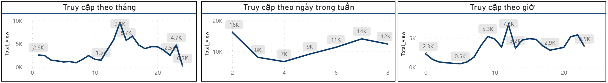
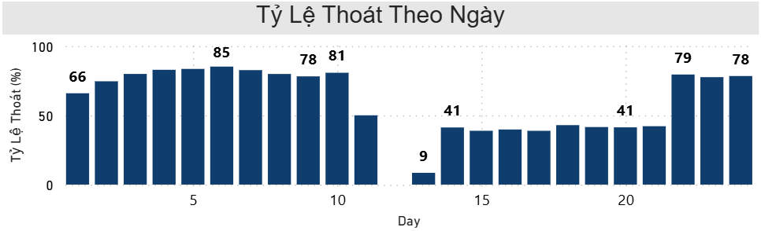
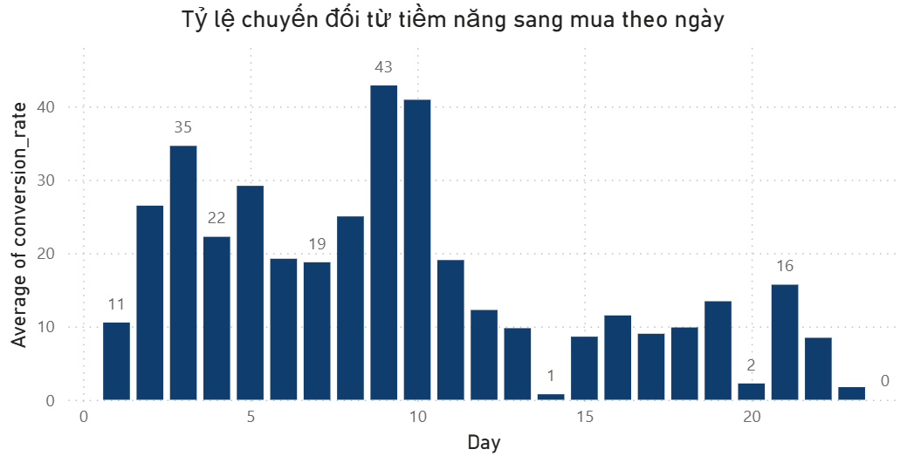
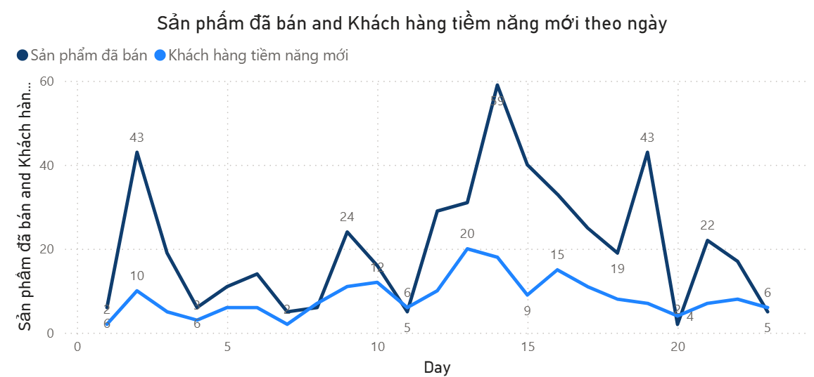
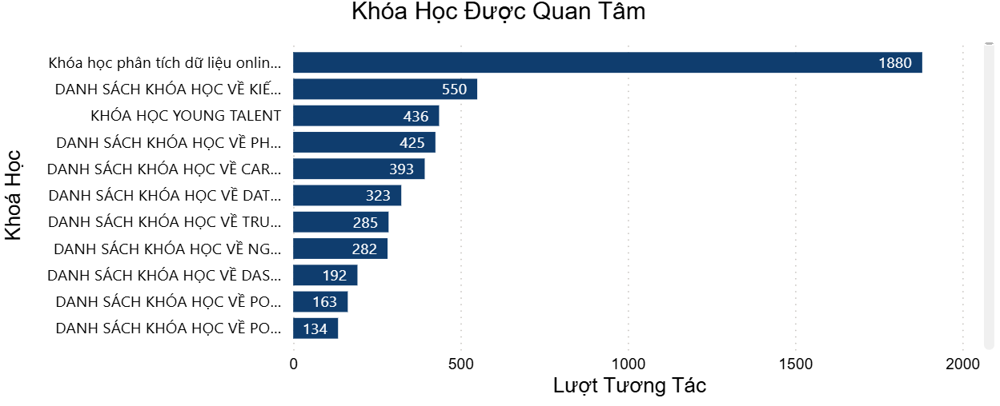
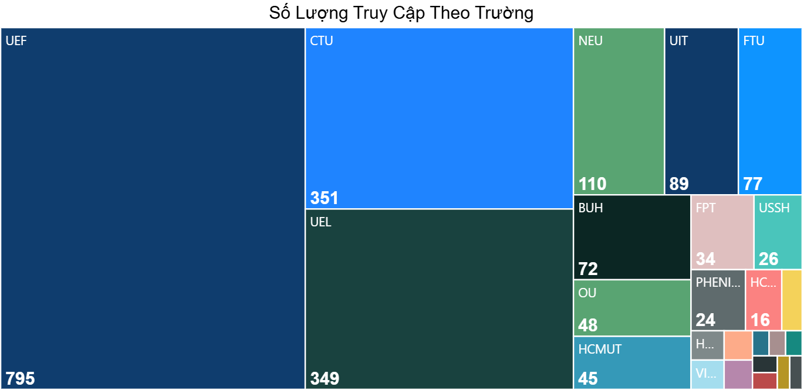

# UNIACE SEO MARKETING - Phân Tích Lưu Lượng Truy Cập Website Tháng 8
### Đánh giá hiệu suất nội dung tiếp cận, hành vi xu hướng người dùng và kết quả kinh doanh trên nền tảng giáo dục trực tuyến Uniace


> **Mục đích dự án:** Phân tích 94.080 bản ghi sự kiện tương tác trên nền tảng giáo dục trực tuyến Uniace trong chiến dịch tháng 08/2021 (01/08/2021 - 24/08/2021). Dự án định lượng hiệu quả thu hút lưu lượng từ kênh SEO/Direct, bóc tách hành vi theo khung giờ, đo lường sức mua lặp lại và xác định nguyên nhân gây thất thoát 94,63% khách hàng tại bước thanh toán giỏ hàng để đưa ra quyết định tối ưu tăng trưởng.

## 📑 Mục lục
1. [Cấu trúc thư mục Repository](#1-cấu-trúc-thư-mục-repository)
2. [Khai phá dữ liệu & Phân nhóm chỉ tiêu](#2-khai-phá-dữ-liệu--phân-nhóm-chỉ-tiêu)
3. [Tổng quan kết quả kinh doanh & Hiệu suất kênh](#3-tổng-quan-kết-quả-kinh-doanh--hiệu-suất-kênh)
4. [Phân tích chuyên sâu Lưu lượng & Chu kỳ giữ chân](#4-phân-tích-chuyên-sâu-lưu-lượng--chu-kỳ-giữ-chân)
5. [Phân tích Hiệu quả Phễu chuyển đổi & Hành vi mua](#5-phân-tích-hiệu-quả-phễu-chuyển-đổi--hành-vi-mua)
6. [Phân tích Tác động Nội dung SEO & Sản phẩm phễu](#6-phân-tích-tác-động-nội-dung-seo--sản-phẩm-phễu)
7. [Phân loại & Xếp hạng Độ phủ Phân khúc Đại học](#7-phân-loại--xếp-hạng-độ-phủ-phân-khúc-đại-học)
8. [Đề xuất chiến lược kinh doanh thực tế](#8-đề-xuất-chiến-lược-kinh-doanh-thực-tế)

---

## 1. Cấu trúc thư mục Repository

```text
UNIACE SEO_MARKETING/
├── .gitignore                              # Chặn file tạm Power BI, OS cache và tệp ẩn
├── README.md                               # Báo cáo tổng hợp phân tích và đề xuất chiến lược
├── data/
│   ├── raw/                                # Dữ liệu gốc (lưu local, bảo mật & ẩn trên GitHub qua .gitignore)
│   │   ├── Uniace_1_clean.csv              # Log tương tác giai đoạn 1 (50.919 dòng)
│   │   ├── Uniace_2_clean.csv              # Log tương tác giai đoạn 2 (23.385 dòng)
│   │   └── Uniace_3_clean.csv              # Log tài khoản và đơn hàng giai đoạn 3 (19.776 dòng)
│   ├── sample/                             # Trích xuất 1.000 dòng mẫu/tệp phục vụ kiểm thử nhanh
│   │   ├── sample_Uniace_1_clean.csv
│   │   ├── sample_Uniace_2_clean.csv
│   │   └── sample_Uniace_3_clean.csv
│   └── data_dictionary.md                  # Từ điển giải nghĩa 19 trường dữ liệu và công thức DAX/SQL
├── sql/
│   └── Uniace_metrics.sql                  # Truy vấn MySQL CTEs tính tỷ lệ chuyển đổi và khách quay lại
├── power_bi/
│   └── Uniace_Dashboard.pbix               # Dashboard tương tác 4 trang (Overview, User_trend, Student, Sales)
├── reports/
│   └── UNIACE SEO MARKETING.pdf            # Báo cáo thuyết trình phân tích chi tiết (20 trang)
└── docs/images/                            # Biểu đồ trích xuất trực tiếp từ hệ thống Power BI Dashboard
    ├── 01_traffic_time_trends.png
    ├── 02_bounce_rate_stages.png
    ├── 03_course_demand_ranking.png
    ├── 04_university_traffic_treemap.png
    ├── 05_lead_to_buyer_conversion.png
    └── 06_daily_orders_sold.png
```

---

## 2. Khai phá dữ liệu & Phân nhóm chỉ tiêu

Quy trình xử lý dữ liệu đi qua 3 bước: (1) Làm sạch hiện tượng xô lệch cột (`IP_Address`, `Email`, `MA_Referrer`, `Datetime`) bằng Excel; (2) Chuẩn hóa định danh và nội suy ngày khuyết bằng hàm cửa sổ `LAG()` / `LEAD()` trên MySQL; (3) Xây dựng mô hình dữ liệu và hệ thống chỉ số DAX trên Power BI. Chi tiết xem tại [data_dictionary.md](data/data_dictionary.md) và [Uniace_metrics.sql](sql/Uniace_metrics.sql).

| Nhóm chỉ tiêu | Các trường / Chỉ số đại diện | Quy tắc xử lý & Ý nghĩa phân tích |
| :--- | :--- | :--- |
| **Dimension (Định danh & Kênh)** | `ID`, `Email`, `IP_Address`, `cuid`, `MA_Referrer`, `University_Student` | Định danh khách vãng lai qua `IP_Address` kết hợp `Email`; tách nhóm Sinh viên đại học và Người dùng phổ thông |
| **Dimension (Nội dung & Thời gian)**| `Name`, `Title`, `MA_URL`, `ma_path`, `Access_type`, `Datetime`, `DayOfWeekNum` | Phân loại chủ đề truy cập (`Dữ liệu`, `Young talent`, `Excel`, `Khóa học`, `Uniace`) và khung giờ tương tác |
| **Fact (Lưu lượng & Tương tác)** | `Total_visits`, `total_user`, `DirectUsers`, `Session_Count`, `Avg_Sessions_Per_User` | Đo lường độ phủ chiến dịch, sức mạnh nhận diện thương hiệu tự nhiên và mật độ tương tác trên mỗi người dùng |
| **Fact (Giữ chân & Rời bỏ)** | `BounceRate`, `Daily_Returning_Rate`, `Monthly_Returning_Rate`, `Monthly_CRR` | Đánh giá chất lượng điểm chạm đầu tiên, khả năng kích hoạt quay lại sau ngày đầu và tỷ lệ giữ chân dài hạn |
| **Fact (Chuyển đổi & Đơn hàng)** | `NewUsers_registered_email`, `NumberOfBuyers`, `AddToCart_To_Purchase_Rate` | Đo lường hiệu suất phễu từ Vãng lai sang Tiềm năng (Email), từ Giỏ hàng sang Đơn hàng (`Completed Order`) |

---

## 3. Tổng quan kết quả kinh doanh & Hiệu suất kênh

Chiến dịch tháng 08/2021 tạo ra độ phủ lớn với **78.000 lượt tương tác** từ **13.619 người dùng duy nhất** (trung bình **5,73 lượt xem/người**). Lưu lượng tập trung mạnh ở 2 kênh chủ lực là truy cập nội bộ/trực tiếp Uniace và tìm kiếm tự nhiên Google.

| Nhóm chỉ số | Chỉ tiêu đo lường | Kết quả thực tế | Tỷ trọng / Hiệu suất | Đánh giá thực trạng |
| :--- | :--- | ---: | ---: | :--- |
| **Độ phủ & Lưu lượng** | Tổng lượt tương tác (`Total_visits`) | 78.000 | 100,00% | Độ tiếp cận cao, trung bình 5,73 lượt xem/người |
| **Độ phủ & Lưu lượng** | Tổng người dùng duy nhất (`total_user`) | 13.619 | 100,00% | Tập khách hàng thực tế phát sinh tương tác |
| **Độ phủ & Lưu lượng** | Truy cập trực tiếp (`DirectUsers`) | 3.607 | 26,48% | Thương hiệu có độ nhận diện tốt, người dùng lưu trang tra cứu |
| **Cơ cấu Kênh nguồn** | Nguồn nội bộ & trực tiếp (`uniace`) | 21.920 | 42,14% | Dẫn đầu lưu lượng điều hướng trên toàn hệ thống |
| **Cơ cấu Kênh nguồn** | Công cụ tìm kiếm `Google` | 20.490 | 39,39% | Kênh SEO chủ lực (cùng Uniace chiếm 81,53% tổng lưu lượng) |
| **Cơ cấu Kênh nguồn** | Công cụ tìm kiếm `Cốc Cốc` & `Beacons` | 5.100 | 9,80% | Cốc Cốc chiếm 5,73% (2.980), Beacons chiếm 4,07% (2.120) |
| **Cơ cấu Đối tượng** | Người dùng phổ thông (`normal_people`) | 2.080 | 92,86% | Nhóm đi làm có nhu cầu tra cứu kỹ năng xử lý dữ liệu thực tế |
| **Cơ cấu Đối tượng** | Học sinh - Sinh viên (`student`) | 160 | 7,14% | Tỷ trọng còn mỏng, mới tiếp cận 147 sinh viên tại 26 trường |
| **Kết quả Kinh doanh** | Người dùng đăng ký Email (`Registered Email`) | 2.239 | 16,44% | Nguồn khách hàng tiềm năng (Lead) phục vụ tiếp thị lại |
| **Kết quả Kinh doanh** | Đơn hàng thành công (`Completed Order`) | 480 | 4,00 đơn/khách | Do 120 khách mua thực tế tạo ra, tỷ lệ mua chéo rất cao |

---

## 4. Phân tích chuyên sâu Lưu lượng & Chu kỳ giữ chân

* **Quy luật thời gian và Khung giờ vàng:** Lưu lượng bùng nổ vào giữa tháng, đạt đỉnh vào **ngày 14/08 với 9.600 lượt xem** trước khi hạ nhiệt về cuối tháng. Theo ngày trong tuần, **Thứ 2 đạt đỉnh cao nhất (16.000 lượt)** do nhu cầu tra cứu phục vụ công việc đầu tuần, theo sau là **Thứ 7 (14.000 lượt)** và **Chủ nhật (12.000 lượt)**. Trong ngày, tương tác hội tụ tại 2 khung giờ vàng: **12h trưa (7.300 lượt)** và **21h - 22h tối (5.300 - 5.500 lượt)**; vùng trũng rơi vào 0h - 5h sáng (0.500 - 2.300 lượt).



* **Sự phân hóa 3 giai đoạn của Tỷ lệ thoát (Bounce Rate) và Khả năng giữ chân:** Toàn chiến dịch ghi nhận **22.000 phiên (trung bình 1,64 phiên/người)**, tỷ lệ thoát trung bình ở mức cao **52,39%**, tỷ lệ quay lại sau ngày đầu (`Returning Rate`) đạt **8,42% (1.146 người)** và tỷ lệ giữ chân dài hạn (`Retention Rate`) chỉ đạt **2,39%**.

| Giai đoạn chiến dịch | Khoảng thời gian | Biên độ Tỷ lệ thoát | Biên độ Tỷ lệ quay lại | Chẩn đoán hành vi người dùng |
| :--- | :--- | :---: | :---: | :--- |
| **Giai đoạn 1: Đầu kỳ** | Ngày 01/08 - 10/08 | **66,0% - 85,0%** | 7,0% - 12,0% | Lưu lượng chủ yếu là khách vãng lai tra cứu nhanh mẹo Excel rồi thoát ngay |
| **Giai đoạn 2: Cao điểm** | Ngày 11/08 - 21/08 | **9,0% - 43,0%** | **12,0% - 16,0%** | Chiến dịch giữa tháng kích hoạt đúng tệp quan tâm khóa học, giữ chân sâu |
| **Giai đoạn 3: Hạ nhiệt** | Ngày 22/08 - 24/08 | **78,0% - 79,0%** | **15,0% - 28,0%** | Sự kiện kết thúc làm khách mới thoát nhanh, nhưng tệp học viên cũ quay lại học đều |



---

## 5. Phân tích Hiệu quả Phễu chuyển đổi & Hành vi mua

* **Điểm nghẽn nghiêm trọng tại bước Thanh toán cuối (94,63% bỏ giỏ hàng):** Hệ thống chuyển đổi tốt từ Khách vãng lai sang Tiềm năng (**14,45%**) và từ Tiềm năng sang Mua (**16,33%**). Tuy nhiên, tỷ lệ từ Giỏ hàng sang Mua thành công (`AddToCart_To_Purchase_Rate`) chỉ đạt **5,37%** - cứ 100 người có ý định mua thêm vào giỏ thì gần 95 người rời bỏ ở bước thanh toán cuối.
* **Sức mua lặp lại cao (4,00 đơn/khách) và sự lệch pha giữa Chốt đơn mới - Sản lượng bán:** Nhóm khách tiềm năng mới tập trung chốt đơn mạnh trong **10 ngày đầu tháng (tỷ lệ chuyển đổi đạt 19% - 43%, đỉnh ngày 09/08 đạt 43%)** khi ngân sách cá nhân dồi dào. Ngược lại, vào ngày 14/08 dù tỷ lệ chốt khách mới chỉ đạt **1%**, tổng sản lượng bán lại lập đỉnh **59 khóa học/ngày** (và đạt 43 khóa vào các ngày 02/08, 19/08) nhờ nhóm học viên hiện hữu gom mua nhiều khóa học cùng lúc (trung bình **4,00 đơn/khách**).

| Tầng phễu chuyển đổi | Chỉ số đo lường | Quy mô / Giá trị | Tỷ lệ chuyển đổi | Nhận định hiệu quả |
| :--- | :--- | ---: | ---: | :--- |
| **Tầng 1: Thu hút (Acquisition)** | Khách vãng lai -> Đăng ký Email | 2.239 Leads | **14,45%** | Hoạt động thu thập Lead hiệu quả cao vào nửa sau tháng (7% - 23%) |
| **Tầng 2: Kích hoạt (Activation)** | Khách tiềm năng -> Khách mua (`Buyer`) | 120 Buyers | **16,33%** | Chốt đơn bùng nổ 10 ngày đầu tháng (đỉnh 43%), suy giảm mạnh cuối tháng |
| **Tầng 3: Thanh toán (Checkout)** | Thêm giỏ hàng -> Hoàn tất đơn hàng | 480 Orders | **5,37%** | **Điểm nghẽn lớn nhất:** Thất thoát 94,63% khách có ý định mua tại giỏ hàng |
| **Tầng 4: Mở rộng (Expansion)** | Số đơn hàng trung bình / Khách mua | 480 / 120 | **4,00 đơn/khách** | Động lực doanh số chính giữa kỳ đến từ khách cũ mua dồn nhiều khóa |





---

## 6. Phân tích Tác động Nội dung SEO & Sản phẩm phễu

* **Chủ đề cốt lõi dẫn dắt tương tác:** Phân loại theo mục đích truy cập (`Access_type`), chủ đề **Dữ liệu dẫn đầu với 20.000 lượt (25,15%)**, tiếp theo là **Young talent với 15.000 lượt (19,09%)**, **Uniace 10.000 lượt (12,83%)**, **Excel 9.000 lượt (12,12%)** và **Khóa học 9.000 lượt (10,92%)**.
* **Sự phân hóa giữa Nội dung hút Traffic và Nội dung tạo Chuyển đổi:** Các bài viết hướng dẫn kỹ thuật Excel thu hút lượng truy cập tự nhiên lớn nhất, nhưng chuỗi nội dung **`young-talent-reactivate`** mới là điểm chạm giữ chân nhóm đã đăng ký email hiệu quả nhất (**234 người dùng có email tương tác**, dẫn đầu toàn bộ danh mục).

| Top bài viết hút Traffic toàn trang (`Total_access`) | Lượt xem | Top trang tương tác của nhóm có Email (`User with email`) | Số User |
| :--- | ---: | :--- | ---: |
| 1. Unique Analytics Center for Everyone - uniace.vn | 7.253 | 1. `young-talent-reactivate` | 234 |
| 2. Hướng Dẫn Cách Copy Giữ Nguyên Giá Trị Trong Excel | 7.059 | 2. `TÀI KHOẢN - uniace.vn` | 186 |
| 3. Chương Trình Young Talent Program - Uniace Việt Nam | 5.778 | 3. `New Account` (Đăng ký tài khoản mới) | 145 |
| 4. TÀI KHOẢN - uniace.vn | 5.667 | 4. `young-talent` | 132 |
| 5. Cách lấy dữ liệu từ bảng này sang bảng khác trong Excel | 4.458 | 5. `Completed Order` (Hoàn tất đơn hàng) | 120 |
| 6. Young Talent Program (Private) - uniace.vn | 2.726 | 6. `Unique Analytics Center for Everyone - uniace.vn` | 110 |
| 7. Khóa học phân tích dữ liệu online (Data analytics) | 2.071 | 7. `Chương Trình Young Talent Program` | 76 |

* **Sản phẩm phễu chủ lực:** Trong 1.228 người quan tâm khóa học (tạo ra 6.710 lượt xem, trung bình **5,46 lần/người**), **"Khóa học phân tích dữ liệu online (Data analytics)"** chiếm ưu thế tuyệt đối với **1.880 lượt tương tác (gấp 3,42 lần khóa xếp thứ 2 là Kiến thức nền tảng với 550 lượt)**, khẳng định nhu cầu thị trường tập trung ở lộ trình nhập môn tổng quan hơn là các kỹ năng ngách lẻ (Power BI 163 lượt, Dashboard 192 lượt).



---

## 7. Phân loại & Xếp hạng Độ phủ Phân khúc Đại học

Hệ thống ghi nhận **425 học viên Uniace đang hoạt động** (nhịp độ học tập dồn mạnh vào giữa tháng từ ngày 13 - 20/08 với đỉnh **207 học viên/ngày** do tính chất kỳ nghỉ hè). Ở tệp sinh viên mới, chiến dịch đã chạm tới **147 sinh viên thuộc 26 trường đại học**, nhưng có sự chênh lệch lớn giữa "lượt truy cập lặp lại" và "số lượng sinh viên thực tế".

| Nhóm phân loại hiệu suất trường | Mã trường đại học tiêu biểu | Lượt truy cập | Số lượng SV | Chẩn đoán đặc điểm tệp sinh viên |
| :--- | :--- | ---: | ---: | :--- |
| **Nhóm A: Chuyển đổi SV xuất sắc** | **UEL** (ĐH Kinh tế - Luật) | 349 | **46 SV** | Độ phủ sinh viên thực tế số 1 toàn mạng lưới (7,59 lượt/SV), phù hợp làm hạt nhân đại sứ |
| **Nhóm B: Tương tác lặp lại siêu cao** | **UEF** (ĐH Kinh tế - Tài chính) | **795** | **9 SV** | Lượt truy cập dẫn đầu toàn bảng nhưng chỉ đến từ 9 SV (88,33 lượt/SV), thiếu độ phủ rộng |
| **Nhóm C: Tiềm năng quy mô khá** | **CTU** (351), **NEU** (110), **UIT** (89), **FTU** (77), **BUH** (72) | 699 | ~55 SV | Nhóm trường kinh tế - công nghệ trọng điểm tại miền Nam và miền Bắc có nhu cầu học dữ liệu cao |
| **Nhóm D: Phân tán nhỏ lẻ** | **OU** (48), **HCMUT** (45), **FPT** (34), **US** (26), **Phenikaa**, **HCMUTE**... | ~250 | ~37 SV | Trải dài ở 19 trường còn lại, mật độ sinh viên mỏng, chưa tạo được hiệu ứng truyền miệng |



---

## 8. Đề xuất chiến lược kinh doanh thực tế

| Nhóm đối tượng / Vấn đề | Phát hiện cốt lõi (Căn cứ định lượng) | Hành động đề xuất cụ thể (Actionable Recommendations) | Kỳ vọng tác động |
| :--- | :--- | :--- | :--- |
| **1. Luồng Thanh toán & Giỏ hàng (Checkout Funnel)** | Tỷ lệ chuyển đổi từ Giỏ hàng sang Mua chỉ đạt **5,37%** (thất thoát **94,63%** khách có ý định mua). | - Rút gọn luồng thanh toán trên web, cho phép chỉnh sửa khóa học trực tiếp trong giỏ và tích hợp nút "Mua ngay" 1 chạm.<br>- Bổ sung cổng thanh toán nhanh (Ví điện tử/QR Pay) và thiết lập kịch bản Email/Remarketing tự động nhắc giỏ hàng bị bỏ quên sau 2 giờ. | Nâng tỷ lệ chuyển đổi giỏ hàng từ **5,37% lên 12% - 15%**, tăng gấp đôi số đơn thành công. |
| **2. Phân phối Ngân sách & Lịch truyền thông** | Traffic đạt đỉnh vào **Thứ 2 (16K), T7 (14K), CN (12K)** tại **12h trưa (7,3K)** và **21h-22h tối (5,5K)**; khách mới chốt đơn mạnh **10 ngày đầu tháng (19% - 43%)**. | - Tập trung ngân sách chiến dịch chốt sale khóa học vào 10 ngày đầu tháng (giai đoạn khách hàng vừa nhận lương).<br>- Xuất bản nội dung chính và tung ưu đãi Flash Sale cố định vào 2 khung giờ vàng (12h00 và 21h00) các ngày Thứ 2, Thứ 7, Chủ nhật; cắt giảm phân phối từ 0h - 5h sáng. | Tối ưu chi phí tiếp thị, giảm tỷ lệ thoát đầu kỳ từ **66% - 85% xuống dưới 50%**. |
| **3. Tối ưu Nội dung SEO & Chuỗi Upsell/Cross-sell** | Bài viết mẹo Excel hút **4.458 - 7.059 views** nhưng ít chuyển đổi trực tiếp; khách đã mua có hành vi gom **4,00 đơn/khách**; khóa Data Analytics hút **1.880 lượt** (gấp 3,4 lần top 2). | - Gắn trực tiếp Call-to-Action (CTA) nhận tài liệu `young-talent-reactivate` ngay giữa các bài viết hướng dẫn Excel top đầu để thu thập Email.<br>- Dùng khóa **Data Analytics Online** làm sản phẩm phễu đầu vào, sau đó kích hoạt chuỗi Email tự động bán chéo (Bundle) các khóa DAX, SQL, Power BI cho **425 học viên hiện hữu** và **120 khách vừa mua**. | Tăng tỷ lệ thu thập Email Lead từ **16,44% lên >22%** và duy trì sức mua **>= 4,0 đơn/khách**. |
| **4. Thâm nhập Phân khúc Sinh viên Đại học** | Tệp sinh viên mới chiếm **7,14%**; **UEL** dẫn đầu với 46 SV (349 views) trong khi **UEF** có tới 795 views nhưng chỉ từ 9 SV; dàn trải 26 trường. | - Ngừng dàn trải nguồn lực ở 26 trường; tập trung tổ chức Workshop thực chiến tại cụm trường kinh tế chủ lực: **UEL, CTU, NEU, FTU**.<br>- Tái cấu trúc thông điệp truyền thông và chương trình giới thiệu bạn bè (Referral) tại **UEF** để chuyển hóa lượng truy cập lặp lại cao thành tài khoản đăng ký mới. | Nâng tỷ trọng phân khúc Sinh viên từ **7,14% lên 15% - 20%** tổng người dùng trong quý tới. |
